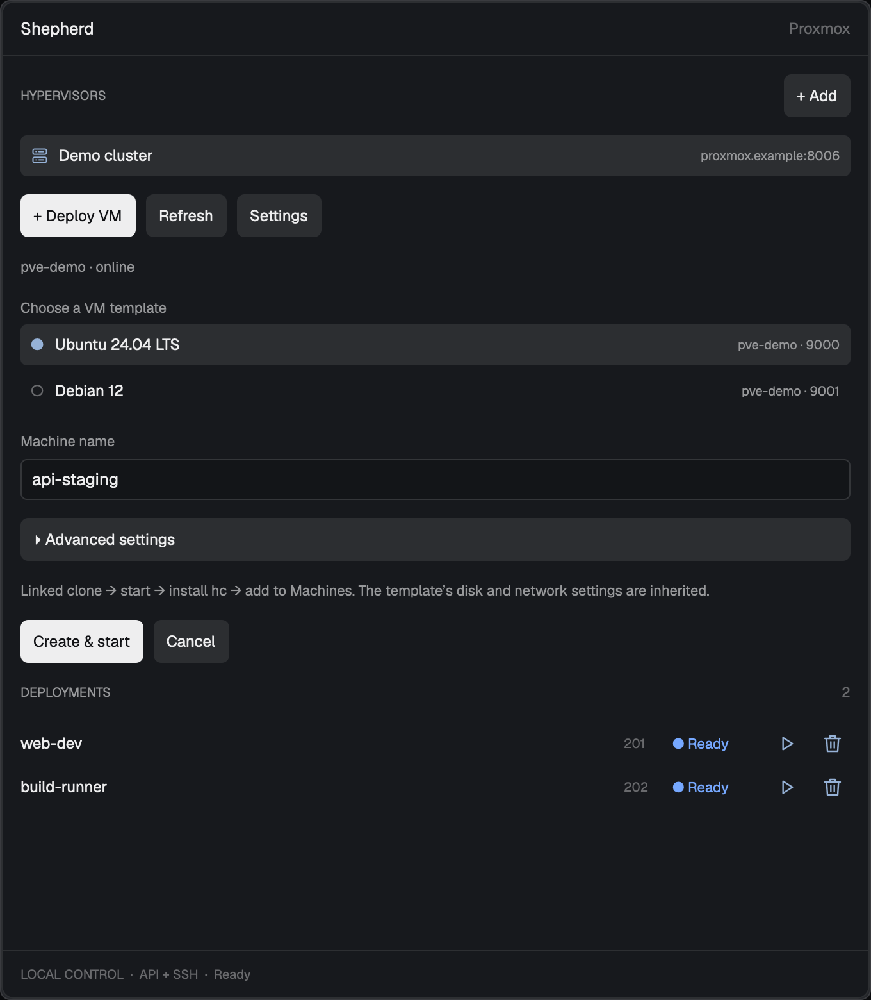

# shepherd

Deploy Proxmox VMs directly from Herdr. Choose a template, **shepherd** clones and configures it to connects the machine to your workspace.



## Requirements

- macOS or Linux with Herdr running, `hc`, Python 3.9+, and OpenSSH.
- Proxmox API token and a local SSH key pair.
- A Linux or Windows QEMU template with QEMU Guest Agent and reachable networking.

## Install

```sh
python3 install.py
```

To update: `python3 install.py --update`.

Installation reuses your personal layout and preserves its other panels. From a shipped layout, it creates and selects a personal copy named **Tabs**. If Tabs already exists, select it first or use `--layout Tabs`. A shipped tab bar is cloned only if needed.

Open **shepherd** beside Files/Changes, add your hypervisor, and select **Deploy VM**. Linked clones are enabled by default.

The bootstrap method is selected automatically from the template's OS type in Proxmox. QEMU Guest Agent configures the SSH account, service, and public key on Linux and Windows.

**shepherd** runs local Python/SSH/`hc` commands and uses the Proxmox API for privileged guest setup. Credentials and job state stay in `~/.config/herdr-app/data/shepherd/` (or your `HERDR_APP_HOME`). SSH uses your configured key files. New Windows accounts receive a random guest-local password with key-only SSH. No administrator or sudo privileges are granted.

Implementation and build details: [RECIPE.md](RECIPE.md).
