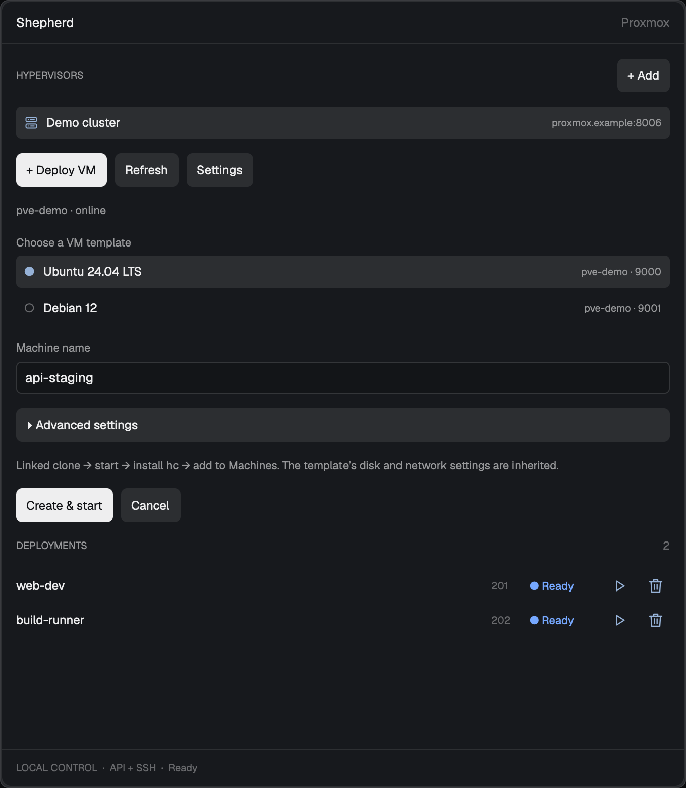

# shepherd

A native Herdr side panel that turns a Proxmox VM template into a connected Herdr machine. A server-icon Shepherd tab sits beside Files and Changes. Select a hypervisor, choose a compatible template, name the machine, and watch a compact deployment row progress to Ready; open its remote workspace with Play.

## What you see

- **Frame:** a 390px-wide side panel, inheriting the main layout's minimum width, with theme background, 1px border, 10px rounded corners, and clipped overflow. All dimensions are logical pixels. Follow the user's theme rather than hardcoding colors.
- **Header:** 42px high, 14px horizontal padding, 13px semibold Shepherd title, and right-aligned 12px dim Proxmox label.
- **Body:** vertically scrollable, 14px padding. The HYPERVISORS heading and + Add precede 32px selectable host rows with 4px gaps, 8px horizontal padding, a 14px server icon, name, and endpoint. Selected rows use the selected background and accent icon. Below: + Deploy VM, Refresh, Settings, and a muted node/status summary.
- **Creation view:** template rows show a selection dot, name, and node plus VMID; unavailable entries are dimmed. Then a machine-name input, collapsible Advanced settings for network bridge and Resource Pool ID, clone-mode summary, Create & start, and Cancel. Inputs are 32px high, with canvas fill, input-colored border, and 5px corners.
- **Settings view:** display name, HTTPS URL, token ID, masked token secret, guest SSH user, local private-key path, bridge, and optional TLS fingerprint. Include a Linked clone checkbox, explanatory text, Save hypervisor, and Back.
- **Deployments:** heading and count, then borderless 34px rows. Each row has a flexible truncated name, 30px VMID column, 67px status column, and 28px action buttons with 16px icons. An empty list shows a padded invitation to choose a compatible template. Deletion confirmation appears inline above the rows.
- **Footer:** 14px horizontal and 10px vertical padding, top border, 10px dim local-control status. Hovering a deployment replaces this with its current phase/error and address; blocked details use the blocked color. Errors appear above the body content in a canvas-colored box.

## How it behaves

- Clicking the Shepherd tab opens its panel; clicking it again hides it. Remember the chosen panel per space. Files and Changes retain their usual behavior. Terminal tabs select on click, rename on double-click, reorder by dragging, open a context menu on right-click, and navigate with the wheel.
- Selecting a hypervisor clears pending deletion, hovered details, and per-VM overrides, then refreshes inventory. Selection is ignored while inventory is loading. Refresh queries the selected host; Add and Settings open the form. Back leaves the form without saving.
- List all visible QEMU templates, sorted by name and VMID. Selecting an available row enables creation. Names contain 1–48 lowercase letters, digits, or hyphens and start with a letter. Blank advanced fields inherit defaults; collapsing the section preserves entered overrides. Successful launch clears the creation inputs.
- Linked clones are the default; unchecking the option creates full clones. New jobs capture the choice. The creation summary and progress messages reflect it.
- Provisioning status **working** uses native quarter-circle frames every 250ms and the theme's working color. **blocked** shows a solid dot and Blocked in the blocked color. **done** shows a solid dot and Ready in the done color. Other states display a hollow dot and Idle with the state color or idle fallback. Deleted rows disappear. These are deployment states, not live agent or VM-power status.
- Terminal agent status remains visible in the tab strip: working has a 900ms rotating spinner, blocked and done have colored dots, idle has no extra marker.
- Poll jobs every 3 seconds while working, otherwise every 15 seconds. Allow only one provisioning/deletion operation across all hypervisors. Play opens a new workspace only when the registered machine is available. Retry resumes a blocked job rather than automatically creating another VM.
- Trash opens a message naming the VM and VMID, with **Confirm deletion** and **Cancel**. Only confirmation starts deletion. Retrying a blocked deletion asks again. Switching or saving another host clears the confirmation. Hover highlights rows/buttons and exposes deployment details; animation does not require polling redraws.
- Optional **Ctrl+Shift+S** opens a 520×740 dialog. **Ctrl+R** refreshes when Shepherd has focus. No custom props are needed. There are no standalone stop, host-removal, or automatic rollback controls.

## Built from

Distribute one folder containing `mods/shepherd/`, `mods/shepherd-tabs/`, `keys.json`, `RECIPE.md`, `preview.png`, `README.md`, `install.py`, and regression tests. Do not ship a `layouts/` folder or runtime credentials/state.

### Native UI and integration

`mods/shepherd/` contains `main.js`, `bridge.py`, `windows-bootstrap.ps1`, `windows-install-core.ps1`, `mod.json`, `config.example.json`, and `server.svg`, `play.svg`, `retry.svg`, `delete.svg`. The installer must copy both PowerShell scripts too. Draw simple outline SVGs: two server racks with indicators, a play triangle, a circular retry arrow, and a trash can. No external artwork is needed. Its manifest is `{"place":"none","size":390,"overlay":{"width":520,"height":740}}`.

Default-export a `View` using `div`/`svg` from `gpui-kit` and `h_flex`, `v_flex`, `Input`, `InputState` from `gpui-base`. Create input states in `init`; use callback-local contexts, `cx.spawn` for asynchronous work, `cx.timer` for data polling, and native `frames` for status animation. Import Herdr's `appHome`, `exec`, `readTextFile`, `writeTextFile`, `theme`, `run`, `machines`, and `nextCommand`. Save configuration with the previously read text as the expected value. Handle `refresh`, `new`, `settings`, and `home` command strings. Play calls `space.new` with the job's name and registered machine.

`shepherd-tabs` is a personal clone of shipped `tabs` (recorded source version 0.1.10), with `place: none`. Add the Shepherd button to the enabled panels. Use `spaces`, `panes`, `layout`, `shared`, `window`, `settings`, `theme`, `run`, and `openOverlay`; remember panels per space in `localStorage`. Preserve `tab.select`, `tab.rename`, `tab.move`, `tab.close`, `tab.next/prev`, window controls, and macOS traffic-light spacing. Toggle `panel` using `layout.show/hide` and select `panel-body` with `layout.select`. Dependencies include shipped `menu`, `new-menu`, `files`, `changes`, `workspace-chrome/spinner.svg`, and `pane/close.svg`; bundle the four window-control SVGs in the clone.

The installer validates both mods, copies runtime files, initializes private state, and merges free shortcuts with a one-time keys backup. Refuse existing mod/layout names unless `--update` is explicit. On first install, call `layout.clone` from `main` to `shepherd`; replace the `tabs` block content with `shepherd-tabs` and append a `shepherd` block under the `panel-body` stack. Show the `panel` at 390px, select Shepherd, and switch to the clone. Updates preserve current layout and panel width/visibility/selection. Require the installed main tree to contain `tabs`, `panel`, and `panel-body`.

The key snippet is `{"global":{"ctrl-shift-s":"mod.open:shepherd"},"mod:shepherd":{"ctrl-r":"shepherd.refresh"}}`.

### Configuration and worker

Keep configuration in `appHome()/data/shepherd/config.json`: a `hypervisors` array with stable `id`, `name`, HTTPS origin `url`, `tokenId`, `tokenSecret`, optional `tlsFingerprint`, `sshUser`, `sshKey`, `linkedClone`, optional `bridge`, and `profiles`. Example profiles match Ubuntu 24.04 and Debian 12 template names with 2 cores and 2048 MiB. Discover every visible QEMU template; merge matching profiles by `templateVmid` or exact template name and assign selector IDs `template-<vmid>`. Profiles can also supply `storage`, `pool`, `bootstrap`, `ipconfig`, and `address`.

Use standard-library Python 3.9+ on macOS/Linux. The UI runs `hc exec -- python3 <bridge> --root <state> <action> [value]`, expecting JSON `{ok,data}` or `{ok:false,error}`. Actions are `init`, `inventory`, `jobs`, `start`, `resume`, `delete`, and internal `worker`. Locate `hc` through PATH and common local/Homebrew paths. Start persistent work with `hc run --bg --no-parent --no-notify --rm --json`, not a detached subprocess under `hc exec`.

Create the state root with mode 0700, atomically write job JSON with mode 0600, and restrict config permissions when loading it in the backend. Store jobs under `jobs/`; serialize launch decisions with `launch.lock` and entire operations with `worker.lock`. Persist attempt UUID, PID, timestamps, VMID/node, task/taskKind, effective `profileSnapshot`, clone mode, overrides, registration intent/target, address, and status/message. A worker checks its attempt before state writes. Polling rereads under the worker lock before marking a dead process or a queue older than 60 seconds blocked. Return the newest 50 jobs.

Connect to Proxmox's `/api2/json/` HTTPS API with an API-token header and system CA validation or a SHA-256 certificate pin checked before sending credentials. Use JSON bodies, except GET/DELETE parameters belong in the query. Inventory reads nodes and cluster VM resources. Preflight verifies local SSH private/public key files, hostname, unique VM name, template, active bridge, and optional pool. Clone on the template's node with `cluster/nextid`, ownership description containing the job ID, `full=0` for linked or `full=1` for full clones; only full clones pass a storage override. Await Proxmox tasks and require exitstatus `OK`.

Configure agent/tags, optional CPU/memory and bridge (preserving the generated MAC and other net0 settings), then start. Discover IPv4 through guest-agent network interfaces, matching net0's MAC when available, with a 600-second deadline. Default guest-agent bootstrap executes a root shell through QGA: install OpenSSH/Python if needed, create the configured SSH user and authorized key, update hostname and `/etc/hosts` idempotently with a one-time backup, regenerate SSH host keys once behind a marker, and enable/restart SSH. Grant no sudo and generate no account password. Optional cloud-init mode requires a standard cloud-init drive, rejects `cicustom`, sets `ciuser`, `sshkeys`, and `ipconfig0`, and waits for cloud-init through SSH.

Probe SSH for up to 180 seconds using BatchMode, IdentitiesOnly, accept-new checking, and per-job `known_hosts.d/<job-id>`. Register via `hc machine add --via <quoted SSH command> --name <name> --install --json`, then verify `hc exec --on <name> -- true`. Persist registration intent before invoking the command; reconcile exact name and target after interruption, including changed DHCP addresses. Preserve legacy known-host paths and stored targets.

Resume existing VMs using the captured profile without requiring their original template. Validate VM name, non-template flag, and ownership description. Reconcile recorded tasks and exit status first; infer legacy task types from UPIDs. Delete uses the same serialized worker: verify ownership and absence of a Proxmox lock, stop and await completion, DELETE with `purge=1`, await completion, then remove only the matching Herdr machine registration. Persist `deleted`; a failed delete with an absent VM stays blocked rather than being assumed successful.

### Windows templates

Select the bootstrap method automatically from the template's Proxmox `ostype` during preflight: values starting with `win` or `w2k` select `windows-ssh`. Other templates use Linux `guest-agent` or the profile's existing `cloud-init` mode. Do not infer the OS from a template name or expose a platform selector. Capture the resolved method in `profileSnapshot` before cloning. On resume, resolve it from the existing VM configuration without requiring its original template.

In `windows-ssh` mode, clone/configure/start and discover IPv4 as usual, then execute `windows-bootstrap.ps1` through QGA with `powershell.exe -NoLogo -NoProfile -NonInteractive -ExecutionPolicy Bypass -EncodedCommand`. Encode the script as UTF-16LE/base64; inject username, public key, and job ID only as base64-encoded JSON data. Validate the username, key, and job ID before constructing it. Allow 900 seconds for the guest process and propagate its output/error when it exits unsuccessfully.

The PowerShell script installs the OpenSSH Server Windows capability if missing; creates the local user with a random cryptographic password generated only inside the guest and adds it to the standard Users group; preserves existing account passwords/privileges and reports disabled accounts. Use SID-based filesystem permissions independent of the Windows language. Store the public key under `ProgramData/shepherd/authorized_keys/<user>` with SYSTEM/Administrators full access and the user read access. Add an idempotent per-user `Match` block before other SSH Match blocks, enforcing that key file and key-only authentication; preserve a one-time original configuration backup and validate a staged configuration with `sshd -t` before replacing it. Generate new default SSH host keys once per job ID (a cloned identity marker from another job must not suppress regeneration). Enable automatic sshd startup, restart it, and add/enable a dedicated inbound TCP 22 firewall rule. A guest-side exclusive file lock prevents concurrent bootstrap runs; reject reparse points on managed paths. Write timestamped phases/errors to `ProgramData/shepherd/bootstrap.log`, never passwords.

Then probe SSH with `cmd.exe /d /c exit 0`. Only on Windows, run `windows-install-core.ps1` as an encoded PowerShell command over that SSH connection, so installation belongs to the guest user rather than SYSTEM. Read and validate the local `hc --version`; pass that release to the official `https://releases.herdr.dev/core/install.ps1` installer through `HC_VERSION`, with the official release origin and `%LOCALAPPDATA%/Programs/herdr-core` destination. The official installer verifies the downloaded release archive checksum. Reuse an already matching binary with ConPTY present, verify the resulting version, and repair the `hc.exe` alias/user PATH as necessary. Allow 600 seconds; a failed installation must block registration.

Register Windows through `hc machine add` without `--install`, including recovery attempts, and verify with `hc exec --on <name> -- cmd.exe /d /c exit 0`. Linux keeps its existing `hc machine add --install` flow and must never invoke the Windows core installer. Never run Unix `true` on Windows. Surface operation failures through the existing blocked-job path, including the last SSH failure. Template OS/Guest Agent/networking problems remain the user's responsibility; do not add template-readiness approval gates. Deletion remains platform-independent.

## Watch out

- Herdr's initial check does not exercise asynchronous states or layout. Test the real app. Keep contexts callback-local and allocate inputs only during initialization; `nextCommand()` returns strings.
- `hc exec` has a short execution limit; persistent work belongs in `hc run`. The local worker needs network access, Python, OpenSSH, and the configured key pair. It reads/writes outside the mod directory and performs remote privileged guest setup.
- Visible templates are not necessarily compatible. Default bootstrap assumes Debian/Ubuntu-style package tools, systemd, a working QEMU Guest Agent, and reachable networking. Cloud-init is optional and has not been verified end-to-end in the recorded live tests. Linked clones require supporting storage; never silently fall back to full clones.
- Blank bridge/pool overrides inherit defaults and cannot explicitly clear them. Pool membership does not impose hardware settings. Do not mutate source templates. Failed tasks retain resources for inspection; Ready means provisioning succeeded, not that the VM is currently running.
- The latest-50-job window is a real limit, not pagination. There is no history archive or per-hypervisor concurrency. The installer requires the current main layout's block IDs, is not transactional, and keeps only a one-time keys backup.
- Guest bootstrap trusts template contents; it does not sanitize all accounts, passwords, machine identities, or packages. The SSH identity marker can be inherited by a derived template. Existing guest-controlled SSH paths are not hardened against symlink races; first SSH contact uses trust-on-first-use. Local file permissions do not isolate hostile code running as the same desktop user. Legacy `passwordlessSudo` is ignored and removed when saving host settings; existing guest privileges are not revoked.
- All authored comments and UI/error strings are English. Remote program/API output and user-provided names may use other languages. Keep credentials and personal deployment history out of the published bundle.
- Windows requires functioning QGA command execution, Windows PowerShell/LocalAccounts, and a working feature source if OpenSSH is missing. The Proxmox OS type must describe the guest correctly. Do not rename or automatically reboot Windows. New accounts use a guest-local random password and key-only SSH; existing account privileges are preserved. Guest processes may outlive a local worker timeout, so retries must honor the guest lock. Windows end-to-end provisioning is not yet verified; tests cover automatic selection, QGA transport, registration/probes, retries, and error propagation.

## Done when

- Both mods pass the native Herdr check and the running app reports no mod errors.
- The panel and dialog render; host selection, template inventory, settings, advanced fields, empty list, and error states work. A real screenshot is saved as `preview.png` beside this recipe.
- Working animation, blocked retry, Ready Play, hover details, and deletion confirmation render correctly; Cancel issues no operation, and changing hosts invalidates pending confirmation.
- Backend tests cover task ordering/failures, resume ownership, serialized launch, stale-worker recovery, profile snapshots, registration recovery, DHCP changes, per-job host keys, override validation, and hostname updates. UI and installer regression suites pass.
- Installer tests demonstrate first-install integration, conflict refusal, shortcut preservation, and update preservation of panel/layout choices.
- In a configured test environment, a compatible clone reaches Ready, appears as a non-temporary connected Herdr machine, and opens a remote terminal. Reloading the panel preserves jobs. Deletion tests verify stop → delete → matching registration removal and failed-task handling; live destructive checks require an explicitly selected disposable VM.
